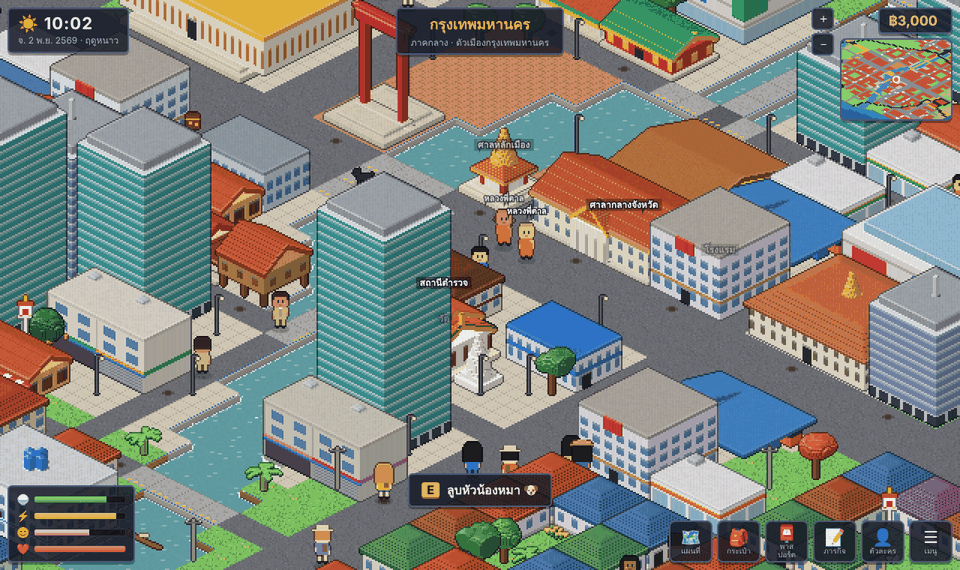
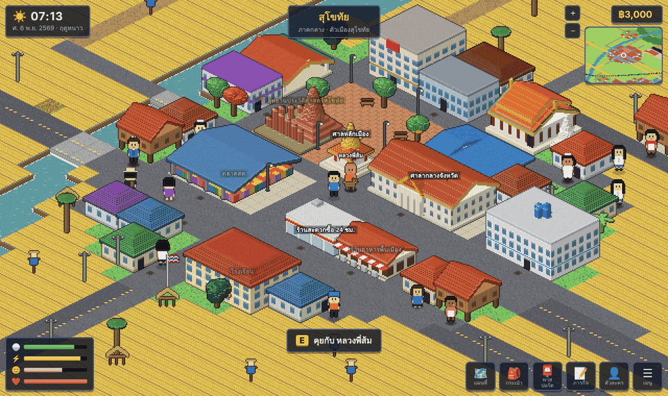
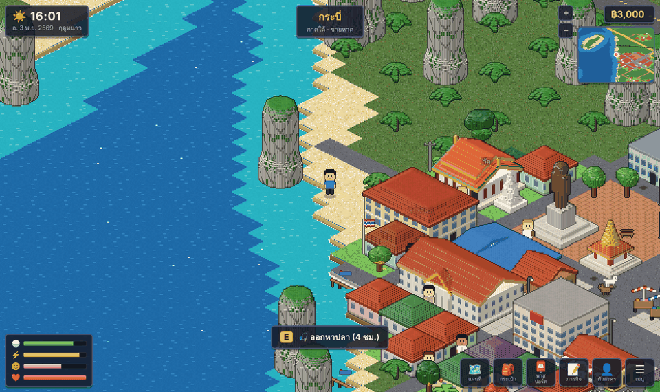
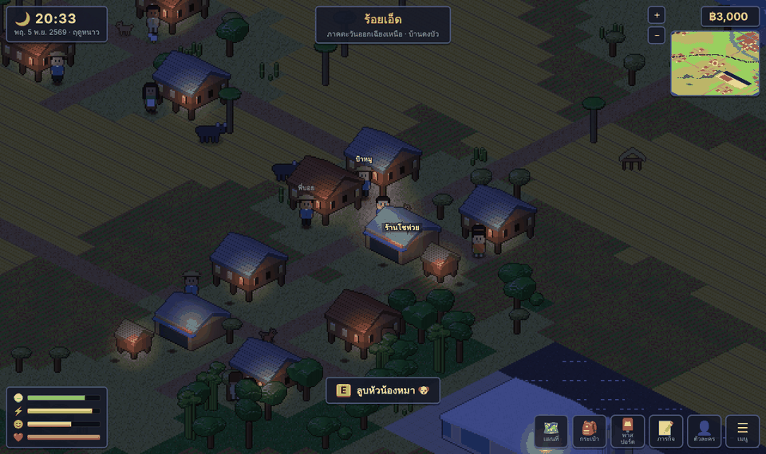

# 🛕 สยาม 77 · Siam77 — ชีวิตจริงใน 77 จังหวัด

โลกจำลองประเทศไทย **77 จังหวัด** ที่เดินสำรวจได้ทั้งประเทศแบบไร้รอยต่อ ใช้ชีวิตได้จริง — ทำงาน กิน นอน เดินทาง
ผูกมิตรกับชาวบ้าน สร้างชื่อเสียง — และวางรากฐานระบบไว้รองรับ **เกมการเมืองเต็มรูปแบบใน Phase 2**

ภาพเป็น **Pixel Art มุมมองเฉียงแบบ 2.5D (isometric)** — แผนที่ ตัวละคร และอาคารทั้งหมดออกแบบและ **สร้างขึ้นด้วยโค้ดทั้งหมด**
ไม่มีไฟล์ภาพภายนอก ไม่ต้องติดตั้ง เล่นออฟไลน์ได้ 100%

| | |
|---|---|
|  |  |
| กรุงเทพฯ — เสาชิงช้า แม่น้ำเจ้าพระยา ตึกระฟ้า | สุโขทัย — อุทยานประวัติศาสตร์กลางทุ่งข้าวสีทอง |
|  |  |
| กระบี่ — เขาหินปูนกลางทะเลอันดามัน | หมู่บ้านอีสานยามค่ำคืน แสงไฟจากบ้านใต้ถุนสูง |

## ▶️ วิธีเล่น

- **ง่ายที่สุด:** ดับเบิลคลิก `standalone.html` (ไฟล์เดียวจบ เล่นออฟไลน์ได้)
- หรือเปิด `index.html` (เวอร์ชันแยกไฟล์สำหรับพัฒนา) หรือรันเซิร์ฟเวอร์ `python3 -m http.server` ในโฟลเดอร์นี้

| ปุ่ม | การทำงาน |
|---|---|
| `WASD` / ลูกศร | เดิน (กด `Shift` ค้างเพื่อวิ่ง) |
| `E` / `Enter` / `Space` | พูดคุย · เข้าอาคาร · ทำงาน/กิจกรรม |
| `M` `I` `P` `J` `C` | แผนที่ · กระเป๋า · พาสปอร์ต · ภารกิจ · ตัวละคร |
| `R` | ขี่/ลงจากจักรยานหรือมอเตอร์ไซค์ |
| `+` / `−` | ซูมกล้อง |
| `Esc` | เมนู บันทึก/โหลด ตั้งค่า |

📱 มือถือ: แตะค้างซีกซ้ายของจอแล้วลากเป็นจอยสติ๊ก ปุ่ม **E** ด้านขวาสำหรับโต้ตอบ

## 🗺️ โลก 77 จังหวัด

- **แผนที่ประเทศไร้รอยต่อ** ~1,000 × 1,800 ช่อง (≈0.9 กม./ช่อง) สร้างแบบกำหนดผลได้ (deterministic) ทุกครั้งที่เปิดเกม ใช้เวลา ~1.5 วินาที
- รูปร่างประเทศ เกาะ (ภูเก็ต สมุย พะงัน เต่า ช้าง ลันตา พีพี …) **แม่น้ำ 18 สาย** (เจ้าพระยา ปิง วัง ยม น่าน โขง มูล ชี …) ทะเลสาบ/เขื่อน และ **เทือกเขา 17 แนว** ออกแบบใหม่ในสไตล์ของเกมเอง
- ภูมิประเทศตามภาค: ทุ่งนา (เปลี่ยนสีตามฤดู: ดำนา → เขียว → **รวงทอง** → ตอซัง) ไร่อ้อย/มันสำปะหลัง ป่าสนภาคเหนือ ป่าดิบชื้น สวนยาง/ปาล์มภาคใต้ สวนผลไม้ภาคตะวันออก ป่าชายเลน ชายหาด เขาหินปูน
- **77 ตัวเมือง** — ทุกจังหวัดมี ศาลากลางจังหวัด ศาลหลักเมือง **แลนด์มาร์กประจำจังหวัด** (เสาชิงช้า ประตูท่าแพ พระธาตุพนม ปราสาทพนมรุ้ง สะพานข้ามแม่น้ำแคว นางเงือกทอง ไดโนเสาร์กาฬสินธุ์ ฯลฯ) วัด ตลาด ร้านสะดวกซื้อ ร้านอาหารพื้นเมือง โรงแรม สถานีขนส่ง โรงพยาบาล โรงเรียน สถานีตำรวจ ธนาคาร ศาลาประชาคม
  สถาปัตยกรรมตามท้องถิ่น: บ้านไม้ล้านนา, เรือนใต้ถุนสูงอีสาน, ตึกแถวชิโน-โปรตุกีส (ภูเก็ต/สงขลา/ตรัง), มัสยิดในชายแดนใต้, ตึกระฟ้าและห้างในกรุงเทพฯ
- **~630 หมู่บ้าน** พร้อมชื่อตามภาษาถิ่น (บ้านโนน… บ้านป่า… บ้านควน… บ้านกำปง…) ผู้ใหญ่บ้าน ร้านโชห่วย วัดประจำหมู่บ้าน ยุ้งข้าว ควาย ไก่ หมา
- **ทางหลวงเชื่อมทุกจังหวัด** (A* + สะพานข้ามแม่น้ำ) ถนนดินเข้าหมู่บ้าน เสาไฟฟ้า สนามบิน 28 แห่ง (ส่วนใหญ่มีรันเวย์นอกเมือง) สถานีรถไฟ 37 จังหวัด ท่าเรือเฟอร์รี่ 13 เส้นทาง

## 🧑‍🌾 ใช้ชีวิตได้จริง

- ⏰ **เวลาและปฏิทิน** พ.ศ. กลางวัน/กลางคืน แสงยามเช้า-เย็น ไฟถนนและแสงจากหน้าต่าง · ฤดูร้อน/ฝน/หนาว · ฝนตก หมอกยามเช้าภาคเหนือ **ฝุ่น PM2.5** · เทศกาล (ลอยกระทง ปีใหม่ สงกรานต์)
- 🍚 **ความต้องการ** ความอิ่ม พลังงาน อารมณ์ สุขภาพ — หมดแรงจะหมดสติและเสียค่ารักษา
- 💼 **งาน 16 แบบ** ทำนา ออกเรือหาปลา กรีดยาง เก็บผลไม้ แม่ค้าในตลาด พนักงานร้านสะดวกซื้อ โรงงาน ออฟฟิศ ครู ผู้ช่วยพยาบาล ลูกจ้างศาลากลาง ไกด์ จิตอาสา **ไรเดอร์ส่งอาหาร** (มีลูกศรนำทางและจับเวลา) — ค่าแรงตามเศรษฐกิจของจังหวัด ทักษะเพิ่มตามงาน
- 🍲 **อาหารขึ้นชื่อ 77 จานและของดี 77 อย่าง** — ซื้อถูกที่ต้นทาง ขายต่างถิ่นได้กำไร (ระบบการค้าข้ามจังหวัด)
- 🏨 นอนโรงแรม หรือ **ซื้อบ้าน** แล้ว **ย้ายทะเบียนบ้าน** · ธนาคาร · จักรยาน/มอเตอร์ไซค์ · ร่ม · กล้อง
- 🚌 เดินทางด่วนด้วย **รถทัวร์ / รถไฟ / เครื่องบิน / เรือเฟอร์รี่** พร้อมแอนิเมชันเส้นทางบนแผนที่
- 👥 **ชาวบ้านมีชีวิต** ทั้งชื่อ อายุ อาชีพ บ้าน ที่ทำงาน ตารางเวลา (ไปทำงาน กลับบ้าน ออกมาเดินเล่นตอนเย็น) เดินด้วย A* พูด**ภาษาถิ่น** (คำเมือง อีสาน ปักษ์ใต้ มลายู) เล่าเรื่องจังหวัดและ**ปัญหาที่เดือดร้อน** · มิตรภาพ ❤ · ให้ของขวัญ · **ภารกิจ** ส่งของ/ซื้อของดี/ไปเที่ยวแทน
- 📮 **พาสปอร์ตเที่ยวไทย** สะสมตราประทับ 77 จังหวัด แลนด์มาร์ก 77 แห่ง และอาหารขึ้นชื่อ 77 จาน
- 🗺️ แผนที่ประเทศ ซูม/ลากได้ 4 โหมด (ภูมิประเทศ ภูมิภาค ที่เคยไป ความสุข) ปักหมุดนำทาง · มินิแมปแบบ isometric
- 💾 บันทึกอัตโนมัติ + 3 ช่องบันทึก (ทำงานได้แม้เบราว์เซอร์บล็อก localStorage)

## 🏛️ รากฐานสำหรับ Phase 2 (เกมการเมือง)

ระบบที่พร้อมให้ต่อยอดแล้วใน Phase 1 (รายละเอียดใน [`docs/PHASE2.md`](docs/PHASE2.md)):

- **สถานะจังหวัด** ประชากร เศรษฐกิจ ความสุข การพัฒนา สิ่งแวดล้อม การศึกษา สาธารณสุข ความปลอดภัย การว่างงาน และ**ปัญหาประจำจังหวัด** ที่เปลี่ยนตามฤดูกาล (น้ำท่วม ภัยแล้ง ฝุ่นควัน ราคาพืชผล รถติด ฯลฯ) — จำลองรายวัน
- **ส.ส. เขต 400 ที่นั่ง** แบ่งตามประชากรด้วยวิธีเศษเหลือมากที่สุด
- **ชาวบ้านทุกคนมีโปรไฟล์ทางการเมือง** (แกนเศรษฐกิจ/สังคม/การกระจายอำนาจ + ความน่าจะไปเลือกตั้ง) และประเด็นที่สนใจ
- **พรรคการเมืองสมมติ 4 พรรค** (ไม่อ้างอิงพรรคจริง) พร้อมการคำนวณความนิยมตัวอย่าง
- ผู้เล่นมี **ชื่อเสียงรายจังหวัด** ทักษะการพูด/ความรู้ ทะเบียนบ้าน เงินฝาก เครือข่ายเพื่อน
- กิจกรรมเชิงพลเมือง: ยื่นข้อเสนอแก้ปัญหาที่ศาลากลาง ประชุมประชาคม เยี่ยมชมรัฐสภา
- สถาปัตยกรรมแบบ **System Registry + Event Bus** — เพิ่มระบบใหม่ได้โดยไม่ต้องแก้ระบบเดิม

## 🗂️ โครงสร้างโปรเจกต์

```
index.html              โครงหน้าเกม (HUD, หน้าต่าง, หน้าโหลด, หน้าแรก)
standalone.html         ไฟล์รวมทุกอย่าง (สร้างด้วย node build.js)
build.js                สคริปต์รวมไฟล์
css/style.css           ธีม UI
js/util.js              namespace, RNG, noise, PixelBuffer, Event Bus, storage
js/data_geo.js          ภูมิศาสตร์: เส้นขอบประเทศ เกาะ ทะเล แม่น้ำ เทือกเขา เฟอร์รี่
js/data_provinces.js    ข้อมูล 77 จังหวัด + เส้นทางรถไฟ
js/data_game.js         ไอเทม อาคาร งาน ชื่อคน บทสนทนา ปัญหา พรรคสมมติ
js/worldgen.js          สร้างโลก: ภูมิประเทศ เขตจังหวัด ตัวเมือง ทางหลวง หมู่บ้าน
js/sprites.js           สร้าง pixel art ทั้งหมด (voxel/span renderer + ตัวละคร)
js/render.js            เรนเดอร์ isometric: chunk cache, depth sort, แสง, สภาพอากาศ
js/systems.js           เวลา อากาศ ความต้องการ จังหวัด เศรษฐกิจ NPC ภารกิจ การเดินทาง
js/game.js              ผู้เล่น การชน การโต้ตอบ การกระทำในอาคาร บันทึกเกม
js/input.js             คีย์บอร์ด จอยสติ๊กสัมผัส เสียงสังเคราะห์
js/ui.js                HUD เมนู ร้านค้า บทสนทนา แผนที่ พาสปอร์ต สร้างตัวละคร
js/main.js              บูตเกมและ game loop
docs/ARCHITECTURE.md    สถาปัตยกรรมโค้ด
docs/PHASE2.md          แผนและจุดเชื่อมต่อสำหรับระบบการเมือง
```

แก้ไขโค้ดแล้วรัน `node build.js` เพื่ออัปเดต `standalone.html`

## ⚠️ หมายเหตุ

- แผนที่ ตำแหน่ง และตัวเลข (ประชากร พื้นที่ ฯลฯ) เป็น **ข้อมูลโดยประมาณที่ปรับให้เหมาะกับการเล่นเกม** ไม่ใช่ข้อมูลทางการ
- ชื่อบุคคล พรรคการเมือง และเหตุการณ์ทั้งหมดในเกมเป็น **เรื่องสมมติ**
